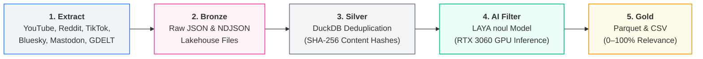
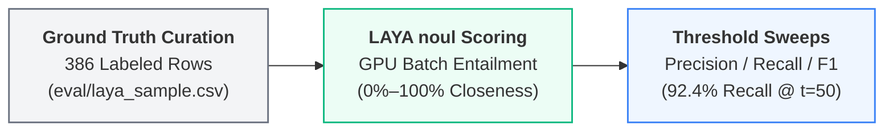

# Pax Silica Discourse Intelligence Pipeline

[-blue.svg)](#architecture)
[](#silver-layer)
[-green.svg)](#ai-semantic-filtering)
[](#dataset-metrics)

An end-to-end, production-grade Medallion ELT and NLP pipeline designed to capture, clean, deduplicate, and semantically score public netizen discourse regarding the U.S.-led **"Pax Silica"** semiconductor and AI infrastructure initiative in the Philippines.

---

## Architecture Flow



---

## Evaluation & Ground-Truth Methodology

To ensure high data quality across multilingual social text (English, Tagalog, and Taglish code-switching), the pipeline incorporates a formal evaluation benchmark:



### Evaluation Benchmark Highlights:
- **Ground Truth Corpus**: 386 labeled rows across YouTube, Reddit, and TikTok.
- **Anchor Recall**: **95% (40/42 anchors)** validated against the human audit queue.
- **Model Formulation**: Uses binary hypothesis entailment (`noul`) rather than multi-class categorical splitting, preventing probability dilution across Taglish comments.
- **Performance**:
  - **Threshold 50**: **92.4% Recall** (captures nearly all relevant discourse).
  - **Threshold 75**: **0.532 F1** (balanced operating point for high-precision analytical slices).

---

## Data Layers (Medallion Standard)

| Layer | Storage Engine | Path | Purpose |
| :--- | :--- | :--- | :--- |
| **Bronze** | Raw JSON / NDJSON | `data/bronze/` | Immutable, verbatim raw payloads from APIs and web scrapers. |
| **Silver** | In-Process OLAP (DuckDB) | `data/silver/pax_silica_staging.duckdb` | Standardized text, SHA-256 deduplicated, with `decision_rating` and `confidence` fields. |
| **Gold** | Columnar Parquet & CSV | `data/gold/pax_silica_corpus.*` | Strongly-typed 4-column analytical export ready for Data Science & NLP. |

### Gold Schema:
* **`platform`** (`VARCHAR`): Originating platform (`reddit`, `youtube_comment`, `tiktok`, `bluesky`, etc.).
* **`decision_rating`** (`INT64`): Continuous **0%–100% closeness percentage** to the Pax Silica anchor.
* **`confidence`** (`INT64`): Model calibration confidence score (0%–100%).
* **`content`** (`VARCHAR`): Cleaned, normalized social media post or comment text.

---

## Hardware Acceleration (GPU Batching)

The semantic filtering phase is powered by native GPU batch execution on PyTorch + CUDA:

* **Hardware**: Tested on **NVIDIA GeForce RTX 3060 (12 GB VRAM)**.
* **Memory Footprint**: ~1.6 GB VRAM allocated on-demand (no system paging bloat).
* **Throughput**: **~25 to 30 records/second** (`batch_size=32`).
* **Runtime**: ~20 seconds per 500 records; ~55 minutes for 100K+ full corpus passes.

---

## Quickstart

### 1. Environment Setup

```powershell
python -m venv venv
.\venv\Scripts\activate
pip install -r requirements.txt
pip install -r requirements-laya.txt
playwright install chromium
```

Copy `.env.example` to `.env` and fill in API credentials if re-running scrapers.

### 2. Ingest Data (Bronze)

```powershell
# Ingest automated API feeds (YouTube, Bluesky, Mastodon, GDELT, RSS)
$env:PYTHONPATH="."; python main.py ingest --track automated

# Extract Reddit comment threads (Headless Playwright)
$env:PYTHONPATH="."; python -u extractors\playwright_reddit_comments.py
```

### 3. Transform & GPU Score (Silver → Gold)

```powershell
# Run GPU scoring on a test limit of 500 records and export Gold
$env:USE_TF="0"; $env:PYTHONPATH="."; python -c "from transforms import ai_filter, exporter; ai_filter.run(limit=500); exporter.export_gold()"

# Or run the full production pass across all unrated records
$env:USE_TF="0"; $env:PYTHONPATH="."; python -c "from transforms import ai_filter, exporter; ai_filter.run(); exporter.export_gold()"
```

### 4. Evaluate Benchmark Metrics

```powershell
# Check precision/recall/F1 sweep and ECE calibration against ground truth
$env:USE_TF="0"; $env:PYTHONPATH="."; python scripts\score_eval.py --metrics-only
```

---

## Sources & Extractors

| Extractor | Platform | Extraction Protocol |
| :--- | :--- | :--- |
| `api_youtube.py` | YouTube | Official YouTube Data API v3 |
| `api_youtube_transcripts.py` | YouTube Transcripts | `youtube-transcript-api` (Speech-to-text extraction) |
| `playwright_reddit.py` | Reddit Posts | Playwright headless browser DOM scraping |
| `playwright_reddit_comments.py` | Reddit Comments | Recursive depth-0 and depth-1 comment tree parser |
| `parser_zeeschuimer.py` | TikTok | Zeeschuimer browser extension NDJSON parser |
| `api_bluesky.py` | Bluesky | AT Protocol API |
| `api_mastodon.py` | Mastodon | Decentralized Mastodon REST API |
| `api_hacker_news.py` | Hacker News | Algolia HN Search API |
| `api_gdelt.py` | Global News | GDELT 2.0 Global Knowledge Graph API |
| `api_rss.py` | News / Blogs | `feedparser` syndicated feeds |
| `scraper_forums.py` | Specialized Forums | `requests` + `BeautifulSoup` HTML extraction |
