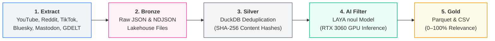
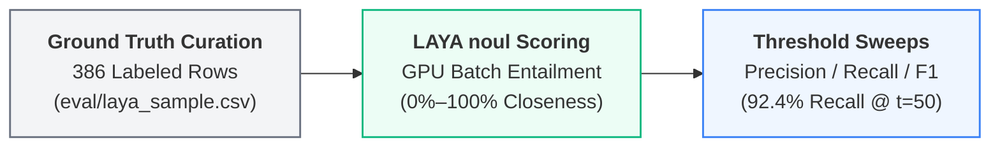
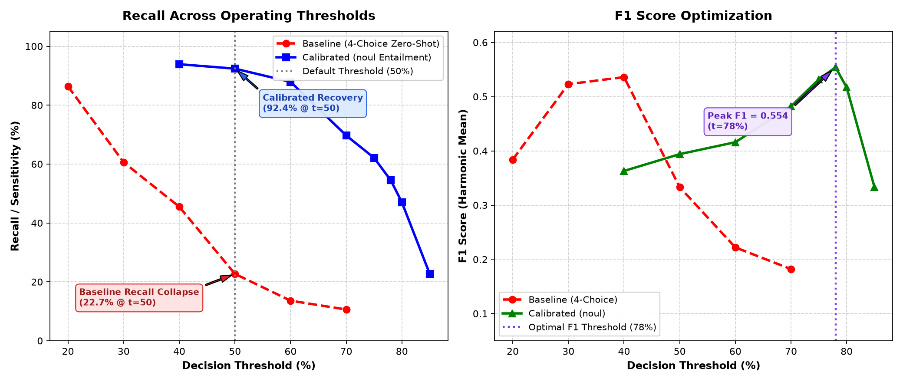

# Pax Silica Discourse Intelligence Pipeline

[-blue.svg)](#architecture)
[](#silver-layer)
[-green.svg)](#ai-semantic-filtering)
[](#dataset-metrics)

An end-to-end, production-grade Medallion ELT and NLP pipeline designed to capture, clean, deduplicate, and semantically score public netizen discourse regarding the U.S.-led **"Pax Silica"** semiconductor and AI infrastructure initiative in the Philippines.

---

## Architecture Flow



---

## Evaluation & Model Calibration Benchmark

To ensure data quality across multilingual social text (English, Tagalog, and Taglish code-switching), the pipeline incorporates a formal evaluation benchmark evaluated on **386 human-labeled ground-truth records** (`eval/laya_sample.csv` across YouTube, Reddit, and TikTok).



### Baseline Zero-Shot vs. Calibrated Entailment



#### 1. The Recall Collapse Problem (Zero-Shot 4-Choice)
Early iterations utilized a standard 4-way multi-class cross-encoder (`unrelated`, `weak`, `direct`, `core`). On colloquial Taglish comments, the model split its probability mass across the positive classes. At the default decision threshold ($t=50\%$), recall **collapsed to 22.7%**, discarding over three-quarters of relevant netizen opinions.

#### 2. The Calibrated Solution (`noul` Binary Entailment)
We reformulated the criteria into a continuous anchor closeness hypothesis (`type: noul`). This restored recall to **92.4% at $t=50\%$** and **95% anchor coverage (40/42 anchors captured)** on human audit records.

| Threshold ($t$) | Baseline Recall | Baseline F1 | **Calibrated Recall** | **Calibrated Precision** | **Calibrated F1** | Operating Role |
| :---: | :---: | :---: | :---: | :---: | :---: | :--- |
| **50%** | 22.7% | 0.333 | **92.4%** | 25.0% | 0.394 | High-Recall Discovery (surfaces all edge discussions) |
| **70%** | 10.6% | 0.182 | **69.7%** | 36.8% | 0.482 | Recommended Annotation Benchmark (~37K records) |
| **75%** | 8.0% | 0.142 | **62.1%** | 46.6% | 0.532 | High-Confidence Discourse Slicing |
| **78%** | 6.5% | 0.115 | **54.5%** | 56.2% | **0.554** | **Optimal F1 Operating Point** (~17K records) |

---

## Upstream Quality Gates & Edge Case Handling

During exploratory data audits, we identified and mitigated three major upstream noise vectors before data reaches the Gold corpus:

1. **Language Gate & Homonym Defense (`PEZA`)**:
   * *Problem*: Ingesting the acronym `PEZA` (*Philippine Economic Zone Authority*) captured European social posts (e.g., Galician/Spanish football commentary where `peza` translates to "piece" or "key player", such as Fermín López news). Uncalibrated cross-encoders gave these scores above 90%.
   * *Mitigation*: Stage 7 in `transforms/cleaner.py` uses `langdetect` to purge non-target languages while `ANCHOR_RE` safeguards explicit project tokens (e.g. `"No to pax silica"`).
2. **Crawler Trailing Domain Stripping**:
   * *Problem*: News scrapers (e.g. GDELT) appended raw domain names (e.g. `\nmanilatimes.net`) to headlines, causing cross-encoder attention to fixate on the domain token and collapsing valid headline scores from **77% down to 8%**.
   * *Mitigation*: Stage 3 in `transforms/cleaner.py` regex-strips trailing web domain suffixes.
3. **Financial Stock Ticker & Mining Query Isolation**:
   * *Problem*: Standalone queries for `"critical minerals"` on Reddit pulled in WallStreetBets penny-stock pumps (e.g., `$FMS.v`, `$TMC`, `$ABAT`) that cross-encoders scored ~65% due to generic mining keywords.
   * *Mitigation*: In `core/config.py`, `"critical minerals"` and `"rare earth"` were demoted to `TIER_3_CONTEXT` (requiring pairing with Philippine anchors). Additionally, Stage 5 in `transforms/cleaner.py` drops posts starting with ticker symbols unless they contain explicit Philippine anchors.

---

## Data Layers (Medallion Standard)

| Layer | Storage Engine | Path | Purpose |
| :--- | :--- | :--- | :--- |
| **Bronze** | Raw JSON / NDJSON | `data/bronze/` | Immutable, verbatim raw payloads from APIs and web scrapers. |
| **Silver** | In-Process OLAP (DuckDB) | `data/silver/pax_silica_staging.duckdb` | Standardized text, SHA-256 deduplicated, with `decision_rating` and `confidence` fields. |
| **Gold** | Columnar Parquet & CSV | `data/gold/pax_silica_corpus.*` | Strongly-typed 4-column analytical export ready for Data Science & NLP. |

### Gold Schema:
* **`platform`** (`VARCHAR`): Originating platform (`reddit`, `youtube_comment`, `tiktok`, `bluesky`, etc.).
* **`decision_rating`** (`INT64`): Continuous **0%–100% closeness percentage** to the Pax Silica anchor.
* **`confidence`** (`INT64`): Model calibration confidence score (0%–100%).
* **`content`** (`VARCHAR`): Cleaned, normalized social media post or comment text.

### Recommended Score Interpretation Bands:
To avoid the false confidence of hardcoding artificial categorical labels onto probabilistic cross-encoder outputs, the Gold corpus preserves continuous `decision_rating` values (0–100%). Downstream analysts should apply the following empirically grounded operating bands:

| Score Band | Corpus Share | Empirical Precision | Recommended Analytical Role |
| :---: | :---: | :---: | :--- |
| **$\ge 75\%$** | ~20.5% (~21.9K records) | **High (~60%–90%)** | **Core Research Slice**: Recommended for sentiment analysis, policy summaries, and topic modeling. Strongly suppresses internet noise and off-topic discourse. |
| **$50\% - 74\%$** | ~32.1% (~34.4K records) | **Moderate (~30%–35%)** | **Discovery / High-Recall Slice**: Captures code-switched opinions, tangential tech, and edge commentary (~92% recall). Ideal for exploratory audits and qualitative review. |
| **$< 50\%$** | ~35.5% (~38.1K records) | **Low (< 8%)** | **Filtered Negatives**: Unrelated conversational chatter, food, memes, general tech, and off-topic social media banter. |

---

## Hardware Acceleration (GPU Batching)

The semantic filtering phase is powered by native GPU batch execution on PyTorch + CUDA:

* **Hardware**: Tested on **NVIDIA GeForce RTX 3060 (12 GB VRAM)**.
* **Memory Footprint**: ~1.6 GB VRAM allocated on-demand (no system paging bloat).
* **Throughput**: **~25 to 30 records/second** (`batch_size=32`).
* **Runtime**: ~20 seconds per 500 records; ~55 minutes for 100K+ full corpus passes.

---

## Quickstart

### 1. Environment Setup

```powershell
python -m venv venv
.\venv\Scripts\activate
pip install -r requirements.txt
pip install -r requirements-laya.txt
playwright install chromium
```

Copy `.env.example` to `.env` and fill in API credentials if re-running scrapers.

### 2. Ingest Data (Bronze)

```powershell
# Ingest automated API feeds (YouTube, Bluesky, Mastodon, GDELT, RSS)
$env:PYTHONPATH="."; python main.py ingest --track automated

# Extract Reddit comment threads (Headless Playwright)
$env:PYTHONPATH="."; python -u extractors\playwright_reddit_comments.py
```

### 3. Transform & GPU Score (Silver → Gold)

```powershell
# Run GPU scoring on a test limit of 500 records and export Gold
$env:USE_TF="0"; $env:PYTHONPATH="."; python -c "from transforms import ai_filter, exporter; ai_filter.run(limit=500); exporter.export_gold()"

# Or run the full production pass across all unrated records
$env:USE_TF="0"; $env:PYTHONPATH="."; python -c "from transforms import ai_filter, exporter; ai_filter.run(); exporter.export_gold()"
```

### 4. Evaluate Benchmark Metrics

```powershell
# Check precision/recall/F1 sweep and ECE calibration against ground truth
$env:USE_TF="0"; $env:PYTHONPATH="."; python scripts\score_eval.py --metrics-only
```

---

## Sources & Extractors

| Extractor | Platform | Extraction Protocol |
| :--- | :--- | :--- |
| `api_youtube.py` | YouTube | Official YouTube Data API v3 |
| `api_youtube_transcripts.py` | YouTube Transcripts | `youtube-transcript-api` (Speech-to-text extraction) |
| `playwright_reddit.py` | Reddit Posts | Playwright headless browser DOM scraping |
| `playwright_reddit_comments.py` | Reddit Comments | Recursive depth-0 and depth-1 comment tree parser |
| `parser_zeeschuimer.py` | TikTok | Zeeschuimer browser extension NDJSON parser |
| `api_bluesky.py` | Bluesky | AT Protocol API |
| `api_mastodon.py` | Mastodon | Decentralized Mastodon REST API |
| `api_hacker_news.py` | Hacker News | Algolia HN Search API |
| `api_gdelt.py` | Global News | GDELT 2.0 Global Knowledge Graph API |
| `api_rss.py` | News / Blogs | `feedparser` syndicated feeds |
| `scraper_forums.py` | Specialized Forums | `requests` + `BeautifulSoup` HTML extraction |
