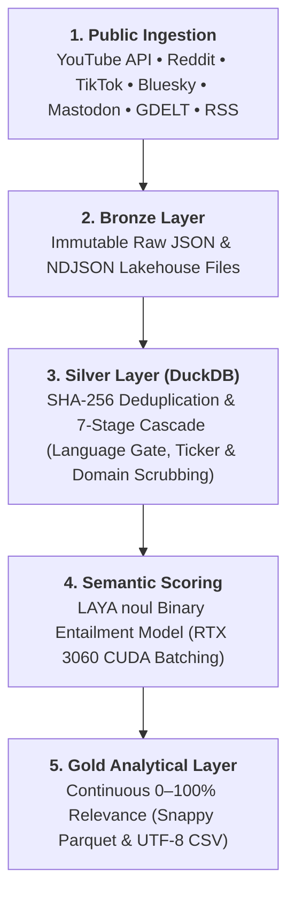
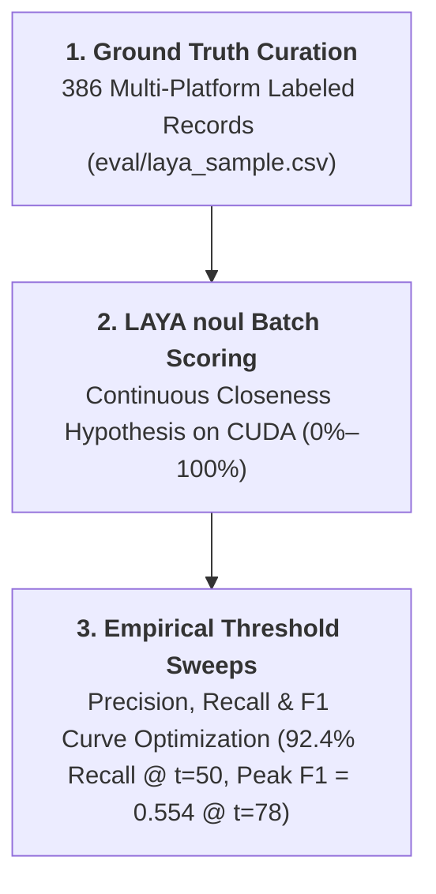
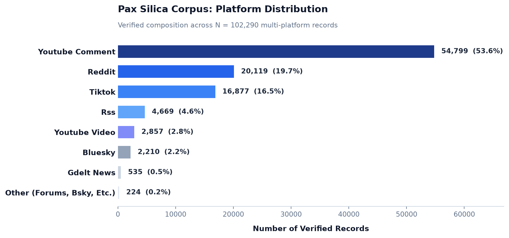
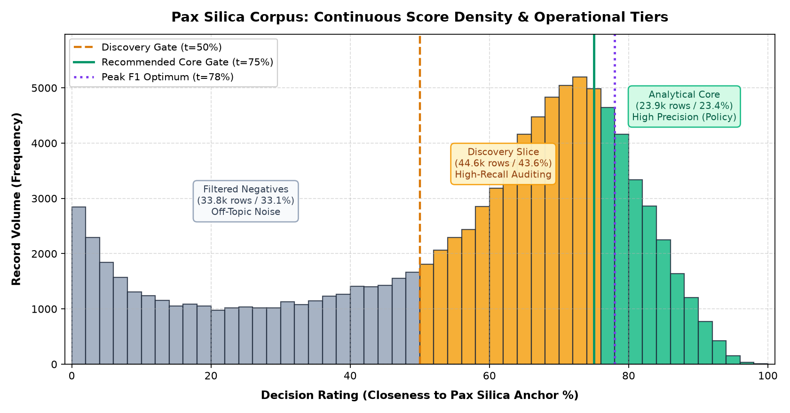

# Pax Silica Discourse Intelligence Pipeline

[-blue.svg)](#architecture-flow)
[](#data-layers-medallion-standard)
[-green.svg)](#evaluation--model-calibration-benchmark)
[](#platform-composition)

An end-to-end Medallion ELT and NLP pipeline designed to capture, clean, deduplicate, and semantically score public netizen discourse regarding the U.S.-led **"Pax Silica"** semiconductor and critical infrastructure initiative in the Philippines.

---

## Architecture Flow



---

## Evaluation & Model Calibration Benchmark

To evaluate semantic filtering across multilingual social discourse (English, Tagalog, and Taglish code-switching), the pipeline was benchmarked against **386 human-labeled ground-truth records** (`eval/laya_sample.csv` across YouTube, Reddit, and TikTok).



### Baseline Zero-Shot vs. Calibrated Entailment


#### 1. The Recall Collapse Problem (Zero-Shot 4-Choice)
Early pipeline iterations utilized a standard 4-way multi-class cross-encoder (`unrelated`, `weak`, `direct`, `core`). On colloquial Taglish comments, the model split its probability mass across the positive classes. At the default decision threshold ($t=50\%$), recall **collapsed to 22.7%**, discarding more than three-quarters of relevant public commentary.

#### 2. The Calibrated Solution (`noul` Binary Entailment)
Reformulating the criteria into a continuous binary entailment closeness hypothesis (`type: noul`) restored recall to **92.4% at $t=50\%$** and captured **95.2% of ground-truth anchors (40/42)**. 

Sweeping decision thresholds revealed an empirical trade-off curve with an optimal harmonic mean ($F_1 = 0.554$) at $t=78\%$:

| Threshold ($t$) | Baseline Recall | Baseline F1 | **Calibrated Recall** | **Calibrated Precision** | **Calibrated F1** | Operating Role |
| :---: | :---: | :---: | :---: | :---: | :---: | :--- |
| **50%** | 22.7% | 0.333 | **92.4%** | 25.0% | 0.394 | High-Recall Discovery (~68.5K records) |
| **70%** | 10.6% | 0.182 | **69.7%** | 36.8% | 0.482 | Recommended Annotation Benchmark (~36.7K records) |
| **75%** | 8.0% | 0.142 | **62.1%** | 46.6% | 0.532 | High-Confidence Discourse Slicing (~23.9K records) |
| **78%** | 6.5% | 0.115 | **54.5%** | 56.2% | **0.554** | **Optimal F1 Operating Point** (~16.8K records) |

---

## Upstream Quality Gates & Edge Case Handling

Audits of raw ingests revealed three specific noise patterns that required upstream deterministic filtering before records reach GPU inference:

1. **Language Gate & Homonym Defense (`PEZA`)**:
   * *Issue*: Ingesting the acronym `PEZA` (*Philippine Economic Zone Authority*) captured European sports commentary (e.g., Galician and Spanish football news where `peza` translates to "piece" or "key player"). Uncalibrated cross-encoders rated these over 90% due to corporate and industrial phrasing.
   * *Mitigation*: Stage 7 in `transforms/cleaner.py` applies `langdetect` to enforce target languages (`en`, `tl`, `fil`, `ceb`, `id`) while preserving whitelisted project anchors (`ANCHOR_RE`).
2. **Crawler Trailing Domain Stripping**:
   * *Issue*: Syndicated news scrapers (e.g. GDELT) appended raw publication domains (e.g., `\nmanilatimes.net`) to headlines. Cross-encoder attention fixated on the domain suffix token rather than the headline content, dropping valid headline scores from **77% down to 8%**.
   * *Mitigation*: Stage 3 in `transforms/cleaner.py` strips trailing domain extensions via regex before tokenization.
3. **Financial Stock Ticker & Mining Query Isolation**:
   * *Issue*: Standalone queries for `"critical minerals"` on Reddit pulled WallStreetBets penny-stock pump threads (`$FMS.v`, `$TMC`, `$ABAT`). Generic mining terminology caused the cross-encoder to score these ~65%.
   * *Mitigation*: In `core/config.py`, `"critical minerals"` was demoted to context terms requiring explicit Philippine anchor pairing. Stage 5 in `transforms/cleaner.py` drops records matching ticker symbols (`$[A-Z]+`) unless paired with geographical anchors.
4. **Silver Database Audit**:
   * Running the updated cascade across the staging DuckDB database purged **4,937 foreign homonyms and ticker rows**, establishing a cleaned Gold analytical baseline of **102,290 records**.

---

## Data Layers (Medallion Standard)

| Layer | Storage Engine | Path | Purpose |
| :--- | :--- | :--- | :--- |
| **Bronze** | Raw JSON / NDJSON | `data/bronze/` | Immutable raw payloads captured directly from extractors. |
| **Silver** | In-Process OLAP (DuckDB) | `data/silver/pax_silica_staging.duckdb` | Cleaned, normalized, and SHA-256 deduplicated records with continuous `decision_rating` scores. |
| **Gold** | Columnar Parquet & CSV | `data/gold/pax_silica_corpus.*` | Strongly-typed analytical export ready for downstream NLP and statistical analysis. |

### Gold Schema

* **`platform`** (`VARCHAR`): Originating platform (`youtube_comment`, `reddit`, `tiktok`, `rss`, etc.).
* **`decision_rating`** (`INT64`): Continuous **0%–100% closeness percentage** to the Pax Silica anchor concept.
* **`confidence`** (`INT64`): Model calibration confidence score (0%–100%).
* **`content`** (`VARCHAR`): Cleaned, normalized text content.

### Platform Composition



The 102,290 verified records are distributed across primary netizen discussion surfaces:
* **YouTube Comments**: 54,799 records (53.6%)
* **Reddit**: 20,119 records (19.7%)
* **TikTok**: 16,877 records (16.5%)
* **RSS / News Feeds**: 4,669 records (4.6%)
* **YouTube Video Transcripts**: 2,857 records (2.8%)
* **Bluesky**: 2,210 records (2.2%)
* **GDELT News**: 535 records (0.5%)
* **Other (Specialized Forums)**: 224 records (0.2%)

### Recommended Score Interpretation Bands

To prevent information loss from hardcoded categorical classifications on probabilistic NLP outputs, the Gold corpus retains continuous `decision_rating` scores (0–100%). Downstream consumers should apply the following empirically grounded operating bands:



| Score Band | Corpus Share | Empirical Precision | Recommended Analytical Role |
| :---: | :---: | :---: | :--- |
| **$\ge 75\%$** | 23.4% (23,911 records) | **High (~60%–90%)** | **Analytical Core**: High-precision slice for sentiment analysis, policy summaries, and executive reporting. Strongly suppresses noise. |
| **$50\% - 74\%$** | 43.6% (44,559 records) | **Moderate (~30%–35%)** | **Discovery Slice**: High-recall slice (~92% recall) capturing code-switched netizen nuance, emerging arguments, and edge commentary. |
| **$< 50\%$** | 33.1% (33,820 records) | **Low (< 8%)** | **Filtered Negatives**: Conversational banter, food, general tech, memes, and off-topic social chatter. |

---

## Ethical Sourcing & Ingestion Boundaries

Data collection strictly adheres to ethical standards and platform terms of service:
* **Public Data Only**: Ingestion is confined to publicly accessible APIs, syndicated RSS feeds, and open community archives.
* **No Authenticated Private Scraping**: The pipeline deliberately excludes walled-garden private networks (e.g., Meta / Facebook private groups or gated feeds) to prevent privacy violations and ensure reproducibility.
* **Respectful Ingestion Rates**: Scrapers implement rate limiting, backoff retries, and headless DOM wait states to minimize server load.

---

## Hardware Acceleration (GPU Batching)

Cross-encoder inference runs on native PyTorch + CUDA:
* **Hardware**: Benchmarked on **NVIDIA GeForce RTX 3060 (12 GB VRAM)**.
* **Memory Footprint**: ~1.6 GB VRAM allocated during inference.
* **Throughput**: **~25 to 30 records/second** (`batch_size=32`).
* **Runtime**: ~20 seconds per 500 records; ~55 minutes for full 100K+ corpus passes.

---

## Quickstart

### 1. Environment Setup

```powershell
python -m venv venv
.\venv\Scripts\activate
pip install -r requirements.txt
pip install -r requirements-laya.txt
playwright install chromium
```

Copy `.env.example` to `.env` and provide API credentials if re-running scrapers.

### 2. Ingest Data (Bronze)

```powershell
# Ingest automated API feeds (YouTube, Bluesky, Mastodon, GDELT, RSS)
$env:PYTHONPATH="."; python main.py ingest --track automated

# Extract Reddit comment threads (Headless Playwright)
$env:PYTHONPATH="."; python -u extractors\playwright_reddit_comments.py
```

### 3. Transform & GPU Score (Silver → Gold)

```powershell
# Score a test limit of 500 records and export Gold
$env:USE_TF="0"; $env:PYTHONPATH="."; python -c "from transforms import ai_filter, exporter; ai_filter.run(limit=500); exporter.export_gold()"

# Run full batch pass across all unrated staging records
$env:USE_TF="0"; $env:PYTHONPATH="."; python -c "from transforms import ai_filter, exporter; ai_filter.run(); exporter.export_gold()"
```

### 4. Evaluate Metrics & Reproduce Figures

```powershell
# Output precision/recall/F1 sweeps against human-labeled ground truth
$env:USE_TF="0"; $env:PYTHONPATH="."; python scripts\score_eval.py --metrics-only

# Regenerate publication-quality evaluation and distribution plots
python scripts\plot_calibration_comparison.py
python scripts\plot_corpus_distribution.py
```

---

## Sources & Extractors

| Extractor | Platform | Extraction Protocol |
| :--- | :--- | :--- |
| `api_youtube.py` | YouTube | Official YouTube Data API v3 |
| `api_youtube_transcripts.py` | YouTube Transcripts | `youtube-transcript-api` (Speech-to-text extraction) |
| `playwright_reddit.py` | Reddit Posts | Playwright headless browser DOM scraping |
| `playwright_reddit_comments.py` | Reddit Comments | Recursive depth-0 and depth-1 comment tree parser |
| `parser_zeeschuimer.py` | TikTok | Zeeschuimer browser extension NDJSON parser |
| `api_bluesky.py` | Bluesky | AT Protocol API |
| `api_mastodon.py` | Mastodon | Decentralized Mastodon REST API |
| `api_hacker_news.py` | Hacker News | Algolia HN Search API |
| `api_gdelt.py` | Global News | GDELT 2.0 Global Knowledge Graph API |
| `api_rss.py` | News / Blogs | `feedparser` syndicated feeds |
| `scraper_forums.py` | Specialized Forums | `requests` + `BeautifulSoup` HTML extraction |
